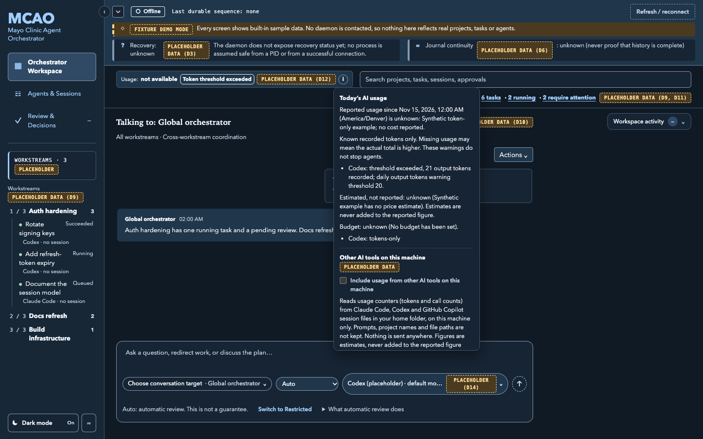

# DPES-747 token-warning UI evidence

Captured on 2026-11-16 from source `7d17cb0cfc1d2dd889c1e07319736efaddf6c60d`
in an isolated Chromium session at 1440 × 900. This is an explicitly labelled
synthetic fixture, with 21 Codex output tokens and a warning threshold of 20.
The fixture reports no monetary amount. It is visual evidence, not a deployed
receiver or provider-billing check.

The warning button opens the actual usage popover. Browser geometry checks
confirmed that the warning and open popover fit inside both 1440 × 900 and
960 × 900 viewports. The temporary fixture input was restored byte for byte
after capture; no synthetic receipt was written to a daemon or provider.

Separate executed checks on the same source revision passed: 16 daemon usage
tests, strict daemon Clippy, the Rust workspace (1,153 passed; two existing
ignored tests), 112 Node tests, 1,636 frontend tests across 77 files, the
frontend build, and 46 UI tests using real locally built daemons. Initial
sandbox IPC failures and the earlier Clippy failure were retained in the
orchestrator's verification evidence; the corrected executions passed.

Native macOS/Windows CI and native WebView visual checks remain separate
gates. The screenshot does not establish cross-browser or mobile support.
The configuration and unknown-count behavior are documented in
[the usage ledger](../../usage-ledger.md#daily-token-warnings-dpes-747).
